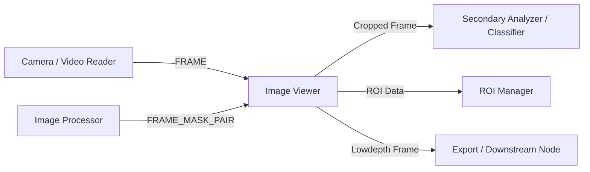

# Image Viewer Module

The **Image Viewer** (`Image_viewer_win`) is a high-performance visual display and analysis module for DearPyGui. It provides real-time GPU texture rendering, interactive Region of Interest (ROI) inspection, dynamic colormapping, intensity rescaling, transparent overlay blending, and automated export pipelines.

---

## Technical Specifications

- **Accepted Inputs**:
  - `FRAME` (`IOTypes.FRAME`, `np.ndarray`): Grayscale, BGR, or BGRA/RGBA images.
  - `FRAME12`, `FRAME16` (`IOTypes.FRAME12`, `IOTypes.FRAME16`): 12-bit or 16-bit high dynamic range images.
  - `FRAME_MASK_PAIR` (`IOTypes.FRAME_MASK_PAIR`, tuple of `(frame, mask)`): Base image with binary/alpha mask overlay.
  - `MASK` (`IOTypes.MASK`, `np.ndarray`): Single-channel boolean or float mask.
  - `ROI_SAMPLE` (`IOTypes.ROI_SAMPLE`, dict): External ROI creation, selection, rename, or deletion commands.
  - `CMD_DICT` (`IOTypes.CMD_DICT`, dict): Control commands (e.g. `{"reset_counter": True}`, `{"clear": True}`).
  - `FILE_PATH`, `FOLDER_PATH` (`IOTypes.FILE_PATH`, `IOTypes.FOLDER_PATH`): Image file paths or target export folders.
- **Outputs**:
  - `Frame` (`IOTypes.FRAME`): Direct pass-through of the received image.
  - `ROI Data` (`IOTypes.ROI_SAMPLE`): Emitted ROI coordinates, names, and statistical thresholds.
  - `Cropped Frame` (`IOTypes.FRAME`): Live cropped sub-image corresponding to the active or hovered ROI.
  - `Lowdepth Frame` (`IOTypes.FRAME`): Normalized 8-bit image with current colormap and intensity scaling applied.

---

## Paramètres et Configuration (Persistent Fields)

| Paramètre | Type | Valeur par défaut | Description |
| :--- | :--- | :--- | :--- |
| **`colorize`** | `bool` | `True` | Active la colorisation et les palettes de fausses couleurs pour les images à un canal. |
| **`intensity_rescaling`** | `bool` | `True` | Active les commandes de recadrage d'intensité (`Auto`, `Inf`, `Sup`). |
| **`fps_counter`** | `bool` | `True` | Active l'affichage en temps réel du compteur FPS. |
| **`image_export`** | `bool` | `True` | Affiche la barre d'outils d'export (presse-papiers, sauvegarde disque PNG, nommage). |
| **`image_depth`** | `str` | `"12bit"` | Interprétation de profondeur de dynamique (`8bit`, `12bit`, `16bit_norm`, `16bit_abs`). |
| **`show_scale`** | `bool` | `True` | Affiche une barre d'échelle d'intensité graduée avec valeurs min/max. |
| **`export_path`** | `Optional[str]` | `None` | Répertoire cible pour les sauvegardes de fichiers images. |
| **`categories_count`** | `int` | `5` | Nombre de catégories pour l'analyse de distribution et l'exportation de palette. |
| **`zero_as_alpha`** | `bool` | `False` | Transforme les pixels de valeur 0 en canal alpha transparent (`alpha=0`). |

---

## Key Features & Controls

### 1. Colorization & Depth
- **Mode**: Toggle between `Normal` and `Negative` (inverted) representation.
- **Palette**: Select colormap (`B&W`, `Inferno`, `Jet`, `HSV`).
- **Depth**: Bit depth interpreter:
  - `8bit`: Unchanged 8-bit dynamic range.
  - `12bit`: 12-bit sensor data shifted by 4 bits (`frame >> 4`).
  - `16bit_norm`: Normalized across image min/max (`cv2.NORM_MINMAX`).
  - `16bit_abs`: Absolute 16-bit data shifted by 8 bits (`frame >> 8`).

### 2. Intensity Rescaling & Autoremap
- **Auto**: Automatically computes the 1st and 100th percentiles of incoming frames to adjust visualization bounds.
- **Inf / Sup**: Manual lower (`Inf`) and upper (`Sup`) thresholds for linear intensity remapping.
- **Scale**: Overlays a vertical color-intensity reference bar with numerical minimum and maximum annotations.

### 3. Interactive Regions of Interest (ROI)
- **Placement**: Hold <kbd>Ctrl</kbd> + Left Click or click <kbd>Middle Mouse Button</kbd> on the image canvas to create a persistent ROI.
- **W / H**: Configurable width and height in pixels for new ROIs.
- **Threshold %**: Percentile threshold filter within the ROI (highlights pixels above the threshold).
- **Mean Value**: Live statistical readout displaying mean and standard deviation for grayscale, or RGB channel averages for color images.
- **Live Crop**: Continuously streams the cropped sub-image inside the selected ROI to the `Cropped Frame` output port.

### 4. Transparency & Alpha Masking
- **Zero as Alpha**: Converts black background pixels (value 0) to transparent alpha pixels (`alpha=0`), allowing underlying graph elements or layers to show through.
- **Crop Limit**: Automatically crops image display and export to the minimal bounding box enclosing non-zero alpha pixels.

### 5. Export & Clipboard Tools
- **Clipboard**: Copies the current processed image directly to the system clipboard for immediate pasting into documents.
- **Save**: Saves both raw and processed images as numbered PNG files to the configured export folder.
- **Category Palette & Result**: Computes custom color bins and copies color definitions (`palette.json`) or distribution statistics (`.tsv`) to the clipboard.

### 6. Display Scaling & Aspect Ratio
- **Proportional Scaling**: All control widths, window bounds, scale bars, and text overlays are scaled with `display_scaling.scale` to ensure crisp, readable UI across HD, 2K, and 4K displays.
- **Configurable Aspect Ratio**: Configurable via `config.json` (`Viewers.image_viewer.preserve_aspect_ratio`):
  - `true` (default): Enforces `equal_aspects=True` on the canvas plot to prevent distortion or stretching when resizing the window.
  - `false`: Sets `equal_aspects=False`, allowing the image to stretch and fit the entire canvas.

---

## Pipeline Integration

